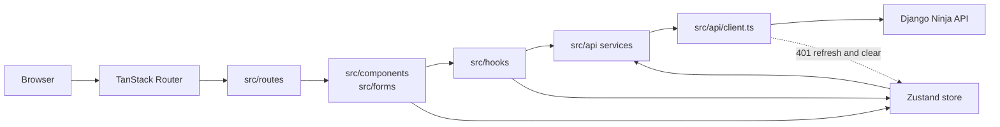

# Architecture

This document records the module boundaries for the React application. Read it
before adding a route, a data source, or a shared component, and update it when
a boundary moves. Visual decisions live in [DESIGN.md](../DESIGN.md); the
delivery workflow lives in [CONTRIBUTING.md](../CONTRIBUTING.md).

## Summary

One React single-page application. Rsbuild compiles it, nginx serves the static
output, and TanStack Router owns the URL. The app is a client of the Django
Ninja boilerplate API: it owns presentation, routing, browser state, and
transport. It owns no database, no server session, and no business rules that
the API must enforce.

## Decisions

| #   | Decision                                                  | Boundary                                     | Reason                                                                                                                                       |
| --- | --------------------------------------------------------- | -------------------------------------------- | -------------------------------------------------------------------------------------------------------------------------------------------- |
| 1   | File-based TanStack Router                                | `src/routes/`                                | URLs, loaders, and route components stay in one place. The router plugin generates `src/routeTree.gen.ts`; never hand-edit it.               |
| 2   | TanStack Query owns server state                          | `src/hooks/queries/`, `src/hooks/mutations/` | Cache, retries, invalidation, and background refresh are one concern, not component state.                                                   |
| 3   | Zustand owns cross-route client state                     | `src/lib/store/`                             | Auth session, appearance, notifications, and the demo todo list are shared by unrelated routes.                                              |
| 4   | One Axios transport                                       | `src/api/client.ts`                          | Base URL, timeout, bearer token, refresh, and the login redirect live in one place. Routes and components never import Axios directly.       |
| 5   | API service modules own the wire format                   | `src/api/`                                   | A service maps backend payloads (`token`, `refresh`) to the app's types (`accessToken`, `refreshToken`). Hooks and components see app types. |
| 6   | Forms own validation                                      | `src/forms/`                                 | React Hook Form plus a Zod schema validates input next to the fields. A route does not duplicate field rules.                                |
| 7   | Copied shadcn/ui and Kibo primitives stay upstream-shaped | `src/components/ui/`                         | Variants and composition extend them. Editing a primitive is reserved for a shared visual or accessibility requirement.                      |
| 8   | Environment access is centralized                         | `src/config/env.ts`                          | Only `PUBLIC_*` variables reach the client. Nothing else reads `import.meta.env`.                                                            |
| 9   | The API is external                                       | `PUBLIC_API_URL`                             | Point the app at the Django Ninja boilerplate. `src/mock-api/` is example data, not a runtime fallback for auth.                             |

## Principles

- **Single responsibility.** A route composes a page, a form validates input,
  a hook owns a query or mutation, an API module owns the wire format, and a
  store slice owns one client concern. A file that needs two of those jobs is a
  signal to split it.
- **Open/closed.** Add a variant or a composed component before editing a
  copied primitive. `src/components/ui/` stays upstream-shaped so a Kibo or
  shadcn update remains a replacement, not a merge.
- **Liskov substitution.** A component that accepts the shadcn/Kibo props must
  keep their behavior and accessibility contract. Do not wrap a primitive with
  a narrower prop surface that silently drops `asChild`, refs, or keyboard
  handling.
- **Interface segregation.** Prefer small hooks and small slices. A route asks
  for the data it renders, not for the whole store. `useAuth`, `useUI`, and
  `useAppConfig` exist so a consumer does not subscribe to every field.
- **Dependency inversion.** Routes and components depend on hooks and service
  functions, not on Axios. `src/api/client.ts` is the only transport import, so
  a base URL, timeout, or refresh change lands in one place.

## Dependency rule

Dependencies point inward and down this list:

| Layer        | Paths                           | May depend on                                  | Must not                                                        |
| ------------ | ------------------------------- | ---------------------------------------------- | --------------------------------------------------------------- |
| Routes       | `src/routes/`                   | `components`, `forms`, `hooks`, `lib`, `types` | Call Axios, own a server cache, or hand-edit the generated tree |
| Composition  | `src/components/`, `src/forms/` | `components/ui`, `lib`, `types`                | Import from `src/routes/` or fetch directly with `fetch`/Axios  |
| Hooks        | `src/hooks/`                    | `api`, `lib/store`, `types`                    | Render UI or hold module-level mutable data                     |
| API services | `src/api/`                      | `api/client`, `config`, `types`                | Import components, hooks, or route modules                      |
| Transport    | `src/api/client.ts`             | `config`, `api/auth-storage`, `lib/store`      | Know about a route, a query, or a domain beyond auth refresh    |
| Store        | `src/lib/store/`                | `api` service modules, `lib/helpers`, `types`  | Import routes, components, or hooks                             |
| Primitives   | `src/components/ui/`            | `lib/utils`, UI dependencies                   | Import app state, hooks, or route code                          |

There is one deliberate cycle: `src/api/client.ts` calls the auth store to
refresh or clear the session on a 401, and the auth slice calls `authApi`. Keep
it confined to auth. A second module that needs the store from transport is a
design change, not a local import.

## Where logic goes

| Kind of logic                             | Home                                                                             |
| ----------------------------------------- | -------------------------------------------------------------------------------- |
| URL shape, route params, page composition | `src/routes/<feature>/`                                                          |
| Reusable presentation and layout          | `src/components/`                                                                |
| Field rules and submit shape              | `src/forms/<domain>/` schema plus component                                      |
| Server reads and writes                   | `src/api/<domain>.ts`, wrapped by `src/hooks/queries/` or `src/hooks/mutations/` |
| Cache keys and invalidation               | The API module (`todoQueryKeys`) or the hook                                     |
| Cross-route state and session             | `src/lib/store/slices/<slice>.ts`                                                |
| Pure helpers                              | `src/lib/helpers/`                                                               |
| Shared class names                        | `src/lib/utils.ts` (`cn`)                                                        |

Do not copy a backend rule into the client. The client validates for feedback;
the API remains the authority.

## State ownership

- **Server state** belongs to TanStack Query. Do not mirror a query result into
  `useState` or Zustand. Pass it down or read the cache through a hook.
- **Session state** belongs to the auth slice: `user`, `tokens`,
  `isAuthenticated`, loading, and error. Token strings live in `localStorage`
  under `AUTH_STORAGE` (`auth_token:v1`, `refresh_token:v1`) so the Axios
  request interceptor can read them without a React render.
- **Appearance** belongs to the UI slice. It starts in `system` mode, follows
  the OS until the user chooses, and then persists that choice under
  `app-store` plus the legacy `theme` key.
- **Demo data** belongs to the todo slice. It is intentionally in memory and
  resets on reload; do not present it as a server-backed list.
- **Form state** belongs to React Hook Form. Do not lift every keystroke into a
  Zustand slice.

## Routing

- Routes are files under `src/routes/`. The filename is the URL.
- A directory starting with `-` is private to its route (`settings/-components`)
  and is not a route segment.
- `src/routeTree.gen.ts` is generated by `@tanstack/router-plugin` during the
  build. Never edit it by hand; let the plugin regenerate it and commit the
  generated result when routes change.
- Route files export `Route` as a named export. The convention check rejects
  `export default function` in route files; the router plugin owns route HMR.
- Preload is intent-based (`defaultPreload: 'intent'`). Shared request logic
  belongs in a query hook so preload and render use the same cache key.

## Authentication and transport

1. `initializeStore()` restores appearance and calls `initializeAuth()`.
2. Initialization calls `GET /auth/me`; it does not trust a cached user.
3. The request interceptor adds `Authorization: Bearer <access token>` when a
   token exists.
4. A 401 on a non-public auth path triggers one refresh through
   `POST /token/refresh`, then repeats the original request. Concurrent requests
   share the same refresh promise in the auth slice.
5. A failed refresh clears the session and redirects to `/auth/login`.
6. Login, registration, passwordless request, and passwordless verification are
   public auth paths and never trigger the refresh loop.

Keep the public-path list in `src/api/client.ts` in sync with any new public
endpoint.

## Build and runtime

- Rsbuild reads `rsbuild.config.ts` and `@rsbuild/plugin-react`.
- The dev server proxies `/api`, `/admin`, `/static/admin`, and `/media` to
  `API_PROXY_TARGET` so the browser sees one origin. Add the proxy target to
  Django's `ALLOWED_HOSTS`.
- Production is a static bundle in nginx. The proxy is development-only.
- Client-visible configuration uses the `PUBLIC_` prefix and is read in
  `src/config/env.ts`.
- Dependency versions are exact. Follow [DEPENDENCIES.md](../DEPENDENCIES.md)
  when adding one.

## Testing boundary

The test policy is in [docs/testing.md](testing.md). In short: smoke tests and
Playwright journeys, no new unit tests. The existing Vitest tests stay as they
are and are not extended by feature work.

## Adding a feature

1. Decide which layer owns each piece with the table above.
2. Add or extend the journey in [docs/product/journeys.md](product/journeys.md)
   when the user-visible flow changes.
3. Add the API service function and its types first.
4. Add the query or mutation hook with an explicit cache key.
5. Build the route, form, and composition from existing primitives.
6. Update [DESIGN.md](../DESIGN.md) before changing the visual system.
7. Run the verification commands in the spec or in
   [CONTRIBUTING.md](../CONTRIBUTING.md).

## Evolution

Keep the single application and the module boundaries until a measured reason
appears. Extract a feature module only when it has its own state, its own tests
surface, or a separate delivery cadence. A new backend endpoint does not create
a frontend module by itself; add a service function and a hook first.

When the API contract changes, update the service module, its types, and every
caller in the same change. Do not add a compatibility layer that keeps two wire
formats alive.
